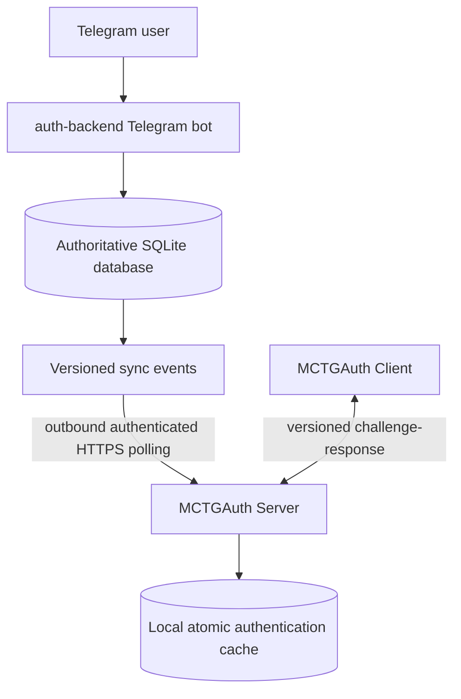

# MCTGAuth

[Русская версия](README_RU.md)

MCTGAuth is a Java 21 authentication and support system for Minecraft 1.21.1 on NeoForge 21.1.244. A Telegram bot manages registration, account ownership, tickets, moderation, and password rotation; separate client and dedicated-server mods perform replay-resistant login without transmitting the plaintext password.

Current version: **0.6.4**.

## Architecture



- `auth-backend` is authoritative for Telegram identities, moderators, tickets, Minecraft-account ownership, credentials, audit history, sync events, and typed remote commands.
- `auth-neoforge-server` polls the backend over outbound HTTPS, keeps the minimum local verifier cache, quarantines unauthenticated players, and validates login proofs.
- `auth-neoforge-client` stores the user-entered password locally and derives the nonce-bound proof off the render thread.
- Minecraft never calls the Telegram API and never reads the backend SQLite database.
- During a backend outage, management and new synchronization stop, but accounts already committed to the server cache remain login-capable.

Version 0.6.0 also adds authenticated outbound server telemetry (20-second heartbeat by default), durable player-event delivery, server status/player lists, backend playtime aggregation, the Telegram Server Information and Requests submenus, paginated moderator player statistics, and independent Telegram bot blocking. See the [0.6.0 release notes](docs/RELEASE_NOTES_0.6.0.md) for the implemented behavior and configuration defaults.

Version 0.6.1 adds optional public moderator comments when resolving or closing support tickets, with transactional history/audit persistence and stale-action protection. See the [0.6.1 release notes](docs/RELEASE_NOTES_0.6.1.md).

Version 0.6.2 fixes Server Information navigation for moderators, adds consistent emoji to its localized submenu buttons, and includes the completed recurring-heartbeat scheduler hardening. See the [0.6.2 release notes](docs/RELEASE_NOTES_0.6.2.md).

Version 0.6.3 was a backend-only deployment build of the 0.6.2 source line; it retained schema 6 and protocol 1. See the [0.6.3 release notes](docs/RELEASE_NOTES_0.6.3.md).

Version 0.6.4 adds opt-in Telegram member tags sourced from an owned Minecraft account, optional reasons for registration rejection, precise localized authentication failures, and structured `RESYNC_PLAYER` diagnostics. It keeps authentication wire protocol 1 and migrates the backend database to schema 7. See the [0.6.4 release notes](docs/RELEASE_NOTES_0.6.4.md).

The client password is intentionally stored as plaintext in its dedicated local JSON configuration. The backend and Minecraft server never store that plaintext. No component may log passwords, API tokens, Authorization headers, verifier material, or reusable proofs.

## Modules

| Module | Responsibility | Documentation |
| --- | --- | --- |
| `auth-api` | Framework-independent domain and synchronization types. | [Project structure](docs/PROJECT_STRUCTURE.md) |
| `auth-backend` | Telegram bot, SQLite authority, moderation, audit, sync and health API. | [English](auth-backend/README.md) · [Russian](auth-backend/README_RU.md) |
| `auth-neoforge-protocol` | Safe wire payloads, compatibility constants, verifier parsing, and proof primitives. | [Protocol](docs/AUTH_PROTOCOL.md) |
| `auth-neoforge-server` | Dedicated-server enforcement, cache, backend polling, and operator commands. | [English](auth-neoforge-server/README.md) · [Russian](auth-neoforge-server/README_RU.md) |
| `auth-neoforge-client` | Settings UI, local credential storage, and automatic authentication. | [English](auth-neoforge-client/README.md) · [Russian](auth-neoforge-client/README_RU.md) |

## Authentication flow

1. A user submits a registration or additional-account ticket in Telegram.
2. An authorized moderator, identified by numeric Telegram ID, approves it.
3. The backend creates an Argon2id verifier and a versioned sync event. The generated plaintext is delivered only to the user.
4. MCTGAuth Server durably applies the event to `mctgauth/accounts.json`, then acknowledges it.
5. Client and server negotiate protocol version 1. The server issues a one-use session and nonce; the client derives a key locally and returns a context-bound HMAC proof.
6. The server consumes the challenge, validates identity and credential version, and releases the player only after success.

See the [authentication protocol](docs/AUTH_PROTOCOL.md) and [end-to-end flow](docs/MCTGAUTH_AUTH_FLOW.md).

## Requirements and development

- 64-bit JDK 21
- Minecraft 1.21.1
- NeoForge 21.1.244
- Git and the included Gradle Wrapper; global Gradle is not required

```powershell
java -version
.\gradlew.bat clean test
.\gradlew.bat build
```

On Linux/macOS use `./gradlew`. For backend development, copy the examples from `.env.example` into process environment variables; the application does not load `.env` automatically. Never commit real values.

## Release artifacts

```text
auth-backend/build/distributions/auth-backend-0.6.4.tar.gz
auth-neoforge-server/build/libs/mctgauth-server-0.6.4.jar
auth-neoforge-client/build/libs/mctgauth-client-0.6.4.jar
```

```powershell
.\gradlew.bat :auth-backend:deploymentArchive :auth-neoforge-server:build :auth-neoforge-client:build
```

Generated binaries belong in release assets, not in the source commit.

## Documentation

- [Documentation index](docs/README.md) · [Russian index](docs/README_RU.md)
- [Upgrade from 0.4.x to 0.5.0](docs/MIGRATION_0.4.x_TO_0.5.0.md) · [Russian](docs/MIGRATION_0.4.x_TO_0.5.0_RU.md)
- [0.5.0 release notes](docs/RELEASE_NOTES_0.5.0.md) · [Russian](docs/RELEASE_NOTES_0.5.0_RU.md)
- [Upgrade from 0.5.0 to 0.6.0](docs/MIGRATION_0.5.0_TO_0.6.0.md) · [Russian](docs/MIGRATION_0.5.0_TO_0.6.0_RU.md)
- [0.6.0 release notes](docs/RELEASE_NOTES_0.6.0.md) · [Russian](docs/RELEASE_NOTES_0.6.0_RU.md)
- [Upgrade from 0.6.0 to 0.6.1](docs/MIGRATION_0.6.0_TO_0.6.1.md) · [Russian](docs/MIGRATION_0.6.0_TO_0.6.1_RU.md)
- [0.6.1 release notes](docs/RELEASE_NOTES_0.6.1.md) · [Russian](docs/RELEASE_NOTES_0.6.1_RU.md)
- [Upgrade from 0.6.1 to 0.6.2](docs/MIGRATION_0.6.1_TO_0.6.2.md) · [Russian](docs/MIGRATION_0.6.1_TO_0.6.2_RU.md)
- [0.6.2 release notes](docs/RELEASE_NOTES_0.6.2.md) · [Russian](docs/RELEASE_NOTES_0.6.2_RU.md)
- [Upgrade from 0.6.2 to 0.6.3](docs/MIGRATION_0.6.2_TO_0.6.3.md) · [Russian](docs/MIGRATION_0.6.2_TO_0.6.3_RU.md)
- [0.6.3 release notes](docs/RELEASE_NOTES_0.6.3.md) · [Russian](docs/RELEASE_NOTES_0.6.3_RU.md)
- [Upgrade from 0.6.3 to 0.6.4](docs/MIGRATION_0.6.3_TO_0.6.4.md) · [Russian](docs/MIGRATION_0.6.3_TO_0.6.4_RU.md)
- [0.6.4 release notes](docs/RELEASE_NOTES_0.6.4.md) · [Russian](docs/RELEASE_NOTES_0.6.4_RU.md)
- [Telemetry API](docs/api/TELEMETRY_API.md) · [Russian](docs/api/TELEMETRY_API_RU.md)
- [Architecture and ownership](docs/PROJECT_LOGIC.md)
- [Security model](docs/architecture/SECURITY_MODEL.md)
- [Backend](auth-backend/README.md)
- [Production deployment](docs/deployment/DEPLOYMENT.md)
- [Troubleshooting](docs/troubleshooting/TROUBLESHOOTING.md)

## Current limitations

- The backend listener is loopback-only; production HTTPS must terminate at a trusted reverse proxy.
- `/mcauth resync <name>` and `/mcauth reload` are explicit unsupported stubs. The typed `RESYNC_PLAYER` remote handler is also currently non-operational because the sync API has no single-account snapshot endpoint.
- No automatic reconnect loop runs after a terminal client authentication failure; reconnect manually after fixing the cause.
- Licensed/online-mode versus offline-mode UUID policy is not yet finalized for deployments that depend on UUID identity changes.
