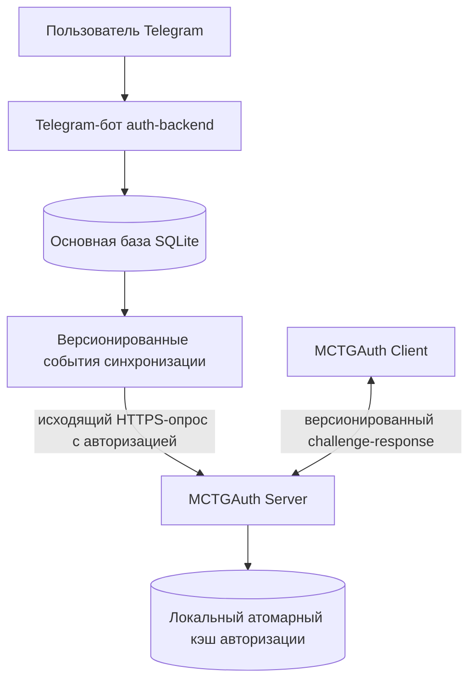

# MCTGAuth

[English version](README.md)

MCTGAuth — система авторизации и поддержки на Java 21 для Minecraft 1.21.1 и NeoForge 21.1.244. Telegram-бот управляет регистрацией, владельцами аккаунтов, обращениями, модерацией и сменой паролей; отдельные клиентский и серверный моды выполняют защищённую от повторного воспроизведения авторизацию без передачи пароля в открытом виде.

Текущая версия: **0.4.1**.

## Архитектура



- `auth-backend` является источником истины для Telegram-пользователей, модераторов, обращений, владельцев Minecraft-аккаунтов, учётных данных, аудита, событий синхронизации и типизированных удалённых команд.
- `auth-neoforge-server` опрашивает backend по исходящему HTTPS, хранит минимальный локальный кэш верификаторов, ограничивает неавторизованных игроков и проверяет доказательства входа.
- `auth-neoforge-client` хранит введённый пользователем пароль локально и вычисляет привязанное к nonce доказательство вне render thread.
- Minecraft не обращается к Telegram API и не читает SQLite-файл backend.
- При недоступности backend операции управления и новая синхронизация останавливаются, но уже записанные в серверный кэш аккаунты могут продолжать входить.

Пароль намеренно хранится открытым текстом только в отдельном локальном JSON-конфиге клиента. Backend и Minecraft-сервер не хранят этот пароль. Нельзя журналировать пароли, API-токены, заголовки Authorization, верификаторы или повторно используемые доказательства.

## Модули

| Модуль | Ответственность | Документация |
| --- | --- | --- |
| `auth-api` | Независимые от фреймворков доменные типы и типы синхронизации. | [Структура проекта](docs/PROJECT_STRUCTURE.md) |
| `auth-backend` | Telegram-бот, SQLite, модерация, аудит, sync и health API. | [English](auth-backend/README.md) · [Русский](auth-backend/README_RU.md) |
| `auth-neoforge-protocol` | Безопасные wire payload, совместимость, разбор верификаторов и proof-примитивы. | [Протокол](docs/AUTH_PROTOCOL.md) |
| `auth-neoforge-server` | Серверные ограничения, кэш, опрос backend и команды оператора. | [English](auth-neoforge-server/README.md) · [Русский](auth-neoforge-server/README_RU.md) |
| `auth-neoforge-client` | Экран настроек, локальный пароль и автоматическая авторизация. | [English](auth-neoforge-client/README.md) · [Русский](auth-neoforge-client/README_RU.md) |

## Поток авторизации

1. Пользователь создаёт в Telegram заявку на регистрацию или дополнительный аккаунт.
2. Авторизованный модератор, определяемый по числовому Telegram ID, одобряет её.
3. Backend создаёт Argon2id-верификатор и событие синхронизации. Сгенерированный пароль получает только пользователь.
4. MCTGAuth Server атомарно записывает событие в `mctgauth/accounts.json`, затем отправляет ACK.
5. Клиент и сервер согласуют версию протокола 1. Сервер создаёт одноразовые session/nonce, а клиент локально вычисляет ключ и возвращает привязанное к контексту HMAC-доказательство.
6. Сервер поглощает challenge, проверяет личность и версию учётных данных и снимает ограничения только после успеха.

См. [протокол авторизации](docs/AUTH_PROTOCOL.md) и [полный поток](docs/MCTGAUTH_AUTH_FLOW.md).

## Требования и разработка

- 64-разрядная JDK 21
- Minecraft 1.21.1
- NeoForge 21.1.244
- Git и Gradle Wrapper из репозитория; глобальная установка Gradle не требуется

```powershell
java -version
.\gradlew.bat clean test
.\gradlew.bat build
```

В Linux/macOS используйте `./gradlew`. Для backend перенесите примеры из `.env.example` в переменные окружения процесса: приложение не загружает `.env` автоматически. Не коммитьте настоящие значения.

## Release-артефакты

```text
auth-backend/build/distributions/auth-backend-0.4.1.tar.gz
auth-neoforge-server/build/libs/mctgauth-server-0.4.1.jar
auth-neoforge-client/build/libs/mctgauth-client-0.4.1.jar
```

```powershell
.\gradlew.bat :auth-backend:deploymentArchive :auth-neoforge-server:build :auth-neoforge-client:build
```

Сгенерированные бинарные файлы прикладываются к Release и не коммитятся в исходный репозиторий.

## Документация

- [Русский индекс](docs/README_RU.md) · [English index](docs/README.md)
- [Архитектура и ответственность](docs/PROJECT_LOGIC.md)
- [Модель безопасности](docs/architecture/SECURITY_MODEL.md)
- [Backend](auth-backend/README_RU.md)
- [Production-развёртывание](docs/deployment/DEPLOYMENT_RU.md)
- [Устранение неполадок](docs/troubleshooting/TROUBLESHOOTING_RU.md)

## Текущие ограничения

- Backend слушает только loopback; production HTTPS должен завершаться на доверенном reverse proxy.
- `/mcauth resync <name>` и `/mcauth reload` — явные неподдерживаемые заглушки. Обработчик `RESYNC_PLAYER` также пока не выполняет действие: sync API не предоставляет snapshot одного аккаунта.
- После терминальной ошибки клиент не запускает автоматический цикл переподключения; после исправления причины подключитесь вручную.
- Политика licensed/online-mode и offline-mode UUID ещё не завершена для развёртываний, зависящих от изменения UUID.
